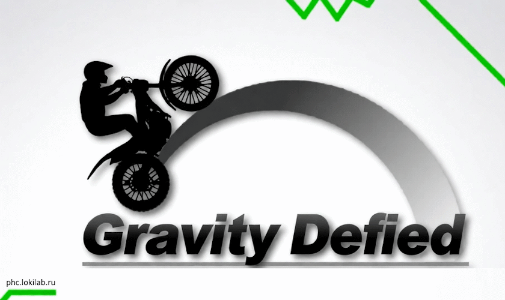

# Gravity Defied Vita

**Gravity Defied** is a legendary mototrial racing mobile game. It was originally developed by Codebrew Software in 2004 for J2ME platform.

This is the C++ & SDL2 port of Gravity Defied, which includes all the features of the original game.

***This Project is not associated with Codebrew Software in any fashion. All rights to the original Gravity Defied, it's name, logotype, brand and all that stuff belong to Codebrew Software.***

# PS Vita Port

**Current version: 1.5**

The game runs natively on the PlayStation Vita at the full 960x544 screen resolution (SDL2 GXM driver), without upscaling or flicker. Save data (settings, progress and highscores) is stored in `ux0:data/GravityDefied/Saves`.

### Controls

| Action | Button |
| --- | --- |
| Accelerate | ✕ / D-pad Up / R / stick up |
| Brake | □ / D-pad Down |
| Lean backward / forward | D-pad Left / Right, left stick |
| **Reverse** | **△ / L1 /** |
| Select in menus | ✕ / △ |
| Back / pause menu | ○ / Start |

### Reverse gear

Unlike the original game, the bike can drive backwards: hold **△** or **L1/L2** while the game is running.

### Dark theme

The Options menu has a **Dark theme** toggle: dark background, blue tracks and white lines instead of the classic white/green look. The setting is saved together with the other options.

### Zoom

The Options menu has a **Zoom** submenu: *Off*, *15%*, *30%*. It scales the in-game view (bike, tracks and camera) so the action is easier to follow on the Vita screen; HUD and menus stay at the native size. The choice is saved together with the other options.

### Custom tracks (Mods)

The port supports third-party track packs (`levels.mrg` files, the same format as the PSP port):

* Put each mod into its own folder inside `ux0:data/GravityDefied/Mods`, e.g. `Mods/MyPack/levels.mrg` (a `*.mrg` file placed directly in `Mods` also works).
* In-game go to **Main menu → Mods** and pick the desired trackpack there. The active pack is remembered between launches.
* Progress (unlocked leagues/tracks) and highscores are saved **separately for every trackpack**, so custom tracks never overwrite the records of the original game.

### Save data (v1.4)

* Settings, unlocked leagues/tracks and highscores live in `ux0:data/GravityDefied/Saves` — separate files for the original game (`GDTRStates`, `00`, `01`, …) and one set per mod (`mod_*` files), so trackpacks never overwrite each other.
* Track packs live in `ux0:data/GravityDefied/Mods`, the selected pack is remembered in `ux0:data/GravityDefied/activeMod`.
* Versions older than 1.4 kept save data directly in `ux0:data/GravityDefied`; the new version no longer reads those files, so they can be safely deleted.

# Authors

### Gravity Defied Cpp authors
* **[rgimad](https://github.com/rgimad)** - idea & coding
* **[AntonEvmenenko](https://github.com/AntonEvmenenko)** - coding
* **[Max Logaev](https://github.com/mxlgv)** - coding

### Gravity Defied Vita
* **[Loki D.S. (Ports Collection)](http://phc.lokilab.ru)** - PS Vita port

### Codebrew GDTR Authors

* **Tors Björn Henrik Johansson** - system/game logic/interface, testing, levels design
* **Set Elis Norman** - graphics/physics/mathematics/system/tools programming, levels design
* **Per David Jacobsson** - physics programming, game graphics, levels design

For more information, please visit official site of Codebrew Software: [codebrew.se](http://codebrew.se)
